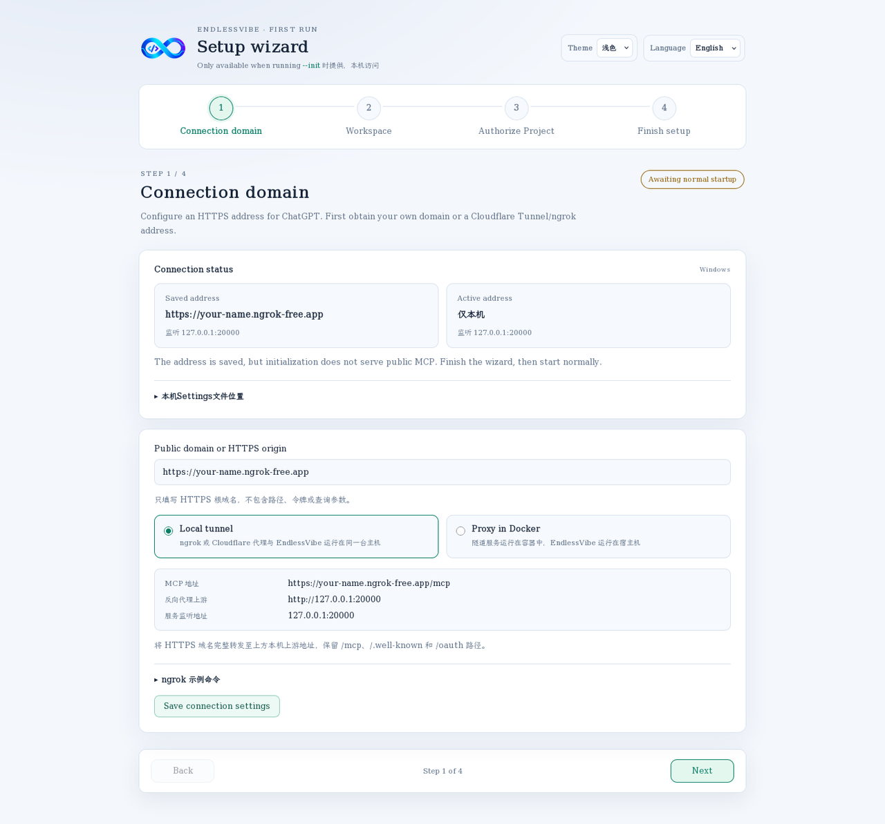
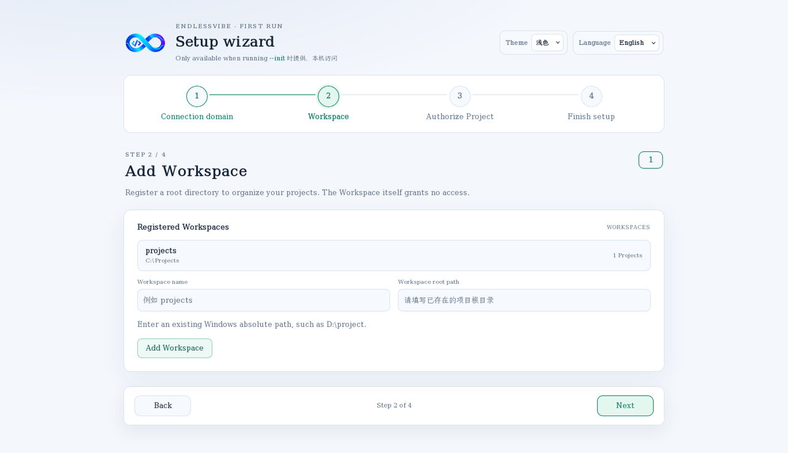
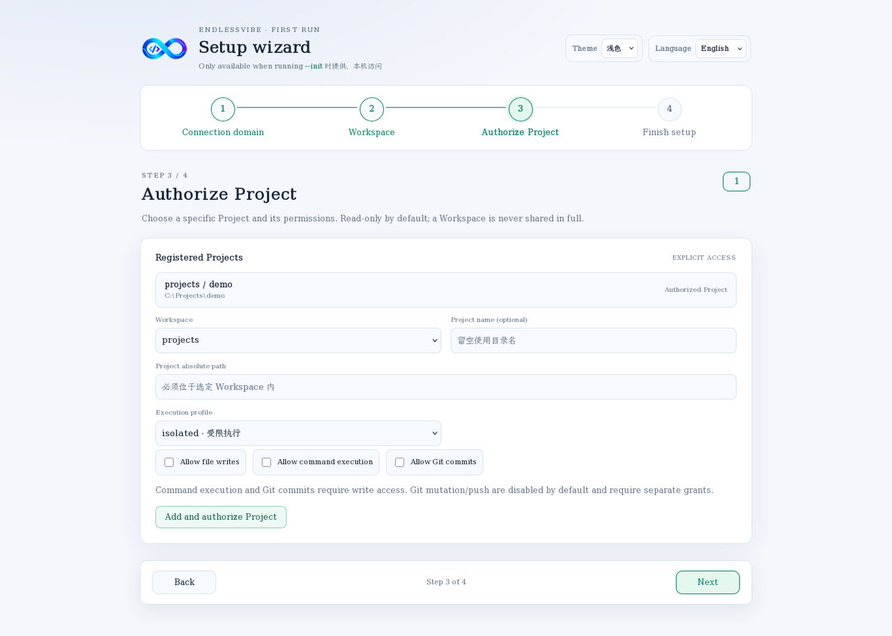
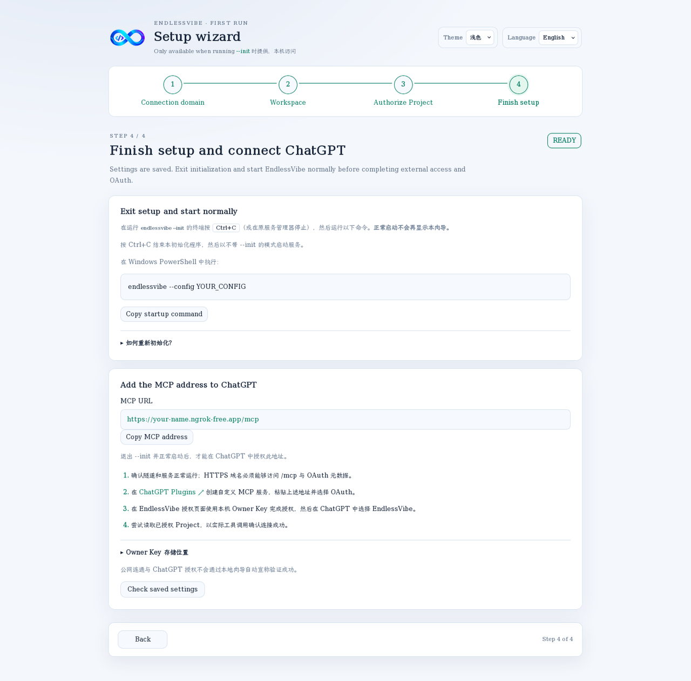
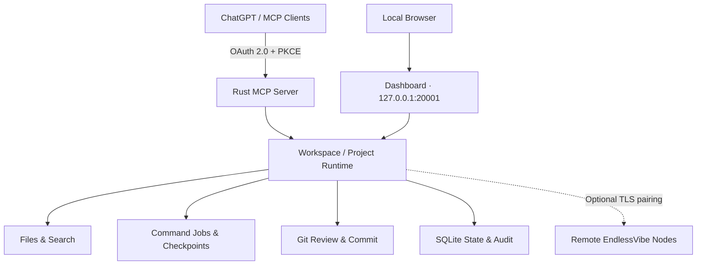

<p align="center">
  
</p>

<p align="center"><a href="README.md">简体中文</a> · <strong>English</strong></p>

<h1 align="center">EndlessVibe</h1>

<p align="center">
  <strong>Connect your local development environment to AI assistants, on your terms.</strong>
  <br>
  A self-hosted Rust MCP server for authorized project access, source editing, command execution, Git workflows, and connected development nodes.
</p>

<p align="center">
  
  
  
  
  <a href="LICENSE"></a>
</p>

<p align="center">
  <a href="#screenshots">Screenshots</a> ·
  <a href="#features">Features</a> ·
  <a href="#quick-start">Quick Start</a> ·
  <a href="#architecture">Architecture</a> ·
  <a href="#security">Security</a> ·
  <a href="#documentation">Documentation</a>
</p>

---

## Overview

**EndlessVibe** connects ChatGPT and other Model Context Protocol (MCP) clients to explicitly authorized local code projects. It includes a browser-based local dashboard for project access, command jobs, audit trails, and node administration.

EndlessVibe is **not** a cloud IDE or a multi-tenant remote shell. It is designed for one owner running their own server, with explicit permissions, per-project coordination, reviewable changes, and recoverable long-running work.

- **MCP Server** — Streamable HTTP transport with OAuth 2.0 authorization.
- **Local Dashboard** — Inspect projects, tasks, activity, operations, configuration, and nodes.
- **Project Runtime** — File APIs, command execution, Git, task checkpoints, and durable jobs.
- **Node Transfer (optional)** — Discover and pair nearby EndlessVibe nodes, then work on explicitly granted remote projects.

## Screenshots

### Setup · Local initialization wizard

Run `endlessvibe --init --web` to configure EndlessVibe in four steps. The progress indicator stays at the top while each screen shows only the active step.

| Step 1 · Connection domain | Step 2 · Add Workspace |
| :---: | :---: |
|  |  |
| Step 3 · Authorize Project | Step 4 · Finish setup |
|  |  |

<sub>Light theme · English interface. All four screenshots are rendered from the actual local Setup page with isolated demonstration data, not live credentials or verified public connectivity.</sub>

### Dashboard


<sub>Light theme · English interface — service status, execution metrics, and the local management dashboard.</sub>

| Projects | Tasks |
| :---: | :---: |
|  |  |
| Workspace / Project access and configuration | Jobs, stages, and checkpoints |

| Operations | Nodes |
| :---: | :---: |
|  |  |
| Auditable operations and execution history | Node discovery, pairing, and request recovery |

<sub>Dashboard / Projects / Tasks / Operations / Nodes screenshots use local service data with machine identifiers redacted. The Setup screenshot uses the actual bundled web UI with isolated example data, not live credentials. Node Transfer remains disabled by default. The Chinese README shows the corresponding Dark / 简体中文 interface.</sub>

## Features

| Area | Capabilities |
| --- | --- |
| **Workspaces & Projects** | Two-level authorization model, per-project file/command/Git permissions, independent operation locks |
| **Files & Search** | Secure directory listing, read/write/create, exact patching, code search, SHA-256 conflict detection |
| **Commands & Jobs** | Asynchronous commands, durable job IDs, paged output, cancellation, timeout, request deduplication |
| **Git Workflow** | Reviewable status/diff/log/commit, optional local Git mutation, separately authorized push |
| **Tasks & Recovery** | `task_id + stage` checkpoints, job association, committed recovery points, restart diagnostics |
| **Initialization / Dashboard** | Local initialization wizard (Web or CLI/Web, depending on build); regular Dashboard provides charts, Projects, Tasks, Operations, Nodes, configuration, and storage |
| **Authentication** | OAuth 2.0 Authorization Code, PKCE, dynamic client registration, tool scopes |
| **Node Transfer** | LAN discovery, TLS pairing, scoped grants, persistent remote request status and history |
| **Execution Profiles** | Linux Bubblewrap and native offline Windows AppContainer, with explicit Project authorization |
| **Docker (optional)** | Restrained Docker Engine operations scoped to explicitly allowed containers |

### Workspace and Project Model

A `Workspace` establishes the filesystem management boundary; a `Project` is the unit of permissions and operations:

```text
Workspace: projects                  /home/user/projects
├── Project: website                 website/
├── Project: kernel                  kernel/
└── Project: tools                   tools/
```

Different Projects can run independent operations concurrently. File changes, commands, and Git mutations on the **same** Project share an operation lock to reduce conflicting changes.

## Quick Start

### Requirements

- **Linux 5.6+, macOS, or Windows 10/11** (macOS and Windows are newly adapted targets; native builds and tests are required before calling them release-ready)
- Rust / Cargo **1.88+**
- Git and a C/C++ compiler toolchain installed on the target operating system
- Linux requires Bubblewrap and unprivileged user namespaces by default. Windows offers a native offline `appcontainer` backend; new Windows/macOS configurations still disable command execution until a backend is selected. Unsandboxed host execution requires explicit acknowledgement

Linux refuses to run as root. Capability-based filesystem access applies to all supported builds; **Bubblewrap is Linux-only, and the Docker Unix Socket transport is not implemented on Windows**. See [Cross-Platform Support and Limitations](docs/PORTABILITY.md).

### 1. Build

From the repository root:

```bash
cargo build --release
cargo test --locked
```

### 2. Start initialization

A downloaded release executable does not require Rust on the recipient's computer. To initialize a new installation or reconfigure an existing one, open a terminal:

```powershell
# Portable Windows EXE copied to another computer
.\endlessvibe.exe --init

# Windows executable compiled from source
.\target\release\endlessvibe.exe --init
```

From a Linux/macOS source build, use `./target/release/endlessvibe --init`.

**Initialization entry points depend on the build.** Check `.\endlessvibe.exe --help` first. If `--cli` and `--web` are listed, bare `--init` offers the interactive menu below (shown here as it appears in the Chinese console):

```text
EndlessVibe · 初始化
1) 命令行交互（推荐）        CLI setup (recommended)
2) Web 网页向导（仅本机）    Local browser setup
? 初始化方式 [1/2] (默认 1):
```

Those builds also accept explicit mode selection:

```powershell
.\endlessvibe.exe --init --cli   # Interactive terminal configuration
.\endlessvibe.exe --init --web   # Local-only browser wizard
```

If `--help` **does not list** `--cli` / `--web`, that build supports Web initialization using bare `--init` only. Do not pass unsupported flags. The legacy `--init --workspace ID=ABSOLUTE_PATH` command is **non-interactive configuration creation and exit**, not the guided terminal UI.

On first launch, initialization creates a private configuration and Owner Key if necessary, but authorizes no Projects by default. Re-initializing an existing installation preserves its Owner Key, settings, and Workspace / Project grants.

### 3. Configure the connection and authorized Projects

Both wizard interfaces follow the same four stages:

1. **HTTPS domain:** enter your own public HTTPS origin, or an origin assigned by Cloudflare Tunnel / ngrok (without `/mcp`). Select a host tunnel or Docker proxy. The resulting MCP address is `https://your-domain/mcp`. Saving it neither creates the tunnel nor tests public reachability.
2. **Workspace:** choose an ID and an **existing absolute directory**, such as `D:\project` on Windows or `/home/user/projects` on Linux. A Workspace is a management root, not an automatic access grant.
3. **Project authorization:** choose explicit Project directories within the Workspace. Confirm write, command-execution and Git Commit permissions individually. Git mutation and Git Push need separate permission grants.
4. **Finish:** review the saved configuration path, MCP URL and normal startup command, then complete OAuth authorization in ChatGPT.

The **CLI wizard** (only when `--cli` appears in the binary's help) prompts within the terminal, previews changes and requires confirmation. Elevated permissions are disabled by default. Type `q` to exit; previously saved stages are retained and can be continued with another `--init --cli`.

The **Web wizard** is served exclusively at [http://127.0.0.1:20001/](http://127.0.0.1:20001/). A progress bar shows four steps and only the active step's form is visible; proceed after saving. Initialization does not launch public MCP/OAuth, Node Transfer or the normal Dashboard. **Never expose management port `20001` to the Internet.**

Example of a host-side tunnel (configure ngrok first, and replace the domain with one assigned to you):

```bash
ngrok http 20000 --url https://your-domain.ngrok.app
```

The proxy must preserve `/mcp`, OAuth and `/.well-known` routes. Its target is the MCP port (normally `20000`), not the Dashboard port.

### 4. Exit setup and start the regular service

- **CLI mode:** the terminal wizard exits after displaying the saved configuration summary.
- **Web mode:** first stop the `--init` process with Ctrl+C or its service manager.

Then start the regular service **without `--init`**:

```powershell
# Portable Windows EXE in the current directory
.\endlessvibe.exe

# Source build
.\target\release\endlessvibe.exe
```

The Linux/macOS equivalent is `endlessvibe` (when on PATH) or `./target/release/endlessvibe`. Normal startup serves the Dashboard at `http://127.0.0.1:20001/` without a Setup tab; public MCP starts only during a normal service launch.

Startup arguments `--bind` / `--public-url` and environment variables `ENDLESSVIBE_BIND` / `ENDLESSVIBE_PUBLIC_URL` may override persisted connection settings. **Saved configuration ≠ public reachability ≠ ChatGPT authorization**: verify the tunnel, OAuth, and an actual MCP tool call separately.

### 5. Connect ChatGPT

Once the HTTPS and OAuth endpoints are available:

1. Open [ChatGPT Plugins](https://chatgpt.com/plugins), then **+ → Add custom MCP server**.
2. Enter a name, description, and `https://your-domain/mcp`. Choose OAuth; EndlessVibe uses its existing dynamic client registration (DCR).
3. Complete the confirmation prompts, choose **Create as a plugin**, review the discovered tools, and install.
4. When prompted, enter your owner key only in **EndlessVibe's OAuth authorization page in your own browser**. No OpenAI API key is needed.
5. Start a new conversation, select EndlessVibe with `@`, and try listing authorized projects.

**Saving a domain or local configuration does not establish a ChatGPT connection.** Complete plugin installation, OAuth consent, and a real tool call. Setup's local checks do not claim to verify public reachability. Keep owner keys, tokens, and login credentials out of MCP URLs and chat messages.

For current UI and account policies, see OpenAI's [connection guide](https://developers.openai.com/plugins/deploy/connect-chatgpt) and [authentication guide](https://developers.openai.com/plugins/build/auth). Other MCP clients use the same HTTPS `/mcp` endpoint and OAuth; see [EndlessVibe OAuth](docs/OAUTH.md) for server details.

### Reopen initialization

**Stop the existing EndlessVibe service before running `--init` again.** The normal service and the initialization process cannot use the same state directory concurrently. On an older Windows build without `--stop` support, use its original terminal or service manager.

```powershell
# Reconfigure a portable Windows installation
.\endlessvibe.exe --init

# Use an existing configuration file
.\endlessvibe.exe --init --config "$env:APPDATA\EndlessVibe\config.toml"

# Only if these flags appear in the binary's --help output
.\endlessvibe.exe --init --cli
.\endlessvibe.exe --init --web
```

Existing configuration comments, the Owner Key and Workspace/Project authorizations are preserved. Use `--status` and `--stop` when supported by the installed service. Normal startup never displays the setup wizard.

### Windows initialization troubleshooting

**1. A copied EXE fails with `execution.path must contain only absolute PATH entries`.**

Older binaries may copy the destination machine's `PATH` verbatim into `execution.path` and then reject empty, relative or unexpanded entries. Prefer a build with the Windows PATH filtering fix. For older binaries, this PowerShell-only workaround changes `PATH` in **the current terminal session only**:

```powershell
$env:PATH = "$env:SystemRoot\System32;$env:SystemRoot"
.\endlessvibe.exe --init
```

Open a fresh PowerShell terminal afterward to restore your normal toolchain PATH. If an existing `config.toml` already contains an invalid `[execution].path`, back up the configuration and correct only that field using actual absolute paths. Never delete your Owner Key to resolve this error.

**2. Setup displays mixed `/` and `\` separators or an Owner Key path beginning with `\\?\`.**

`\\?\` is a Windows extended-length path prefix, often returned by path canonicalization (for example `\\?\C:\Users\user\...`). It does not indicate a corrupted key. User-facing paths should be presented in ordinary Windows form; older builds may still display the native prefix. Do not edit the key file on account of its displayed prefix.

```text
Local configuration file
C:\Users\<user>\AppData\Roaming\EndlessVibe\config.toml

Owner Key file
C:\Users\<user>\AppData\Local\EndlessVibe\owner.key
```

The corresponding environment variables are `$env:APPDATA` and `$env:LOCALAPPDATA`. **Never distribute the Owner Key with an EXE or paste it into an MCP URL or chat message.**

**3. The wizard is unavailable, or ChatGPT cannot connect after saving a domain.**

Check `http://127.0.0.1:20001/` locally, the running service status, and the external tunnel configuration. Setup only saves local settings; it does not create a tunnel or finish OAuth in ChatGPT. If an old service already occupies the management port, stop it before starting the wizard.

### Optional: non-interactive CLI initialization (legacy)

Before a configuration exists, the original command-line workflow remains available. Explicit `--init --workspace ...` creates the configuration and exits; existing configurations are never overwritten:

```bash
mkdir -p "$HOME/projects"

./target/release/endlessvibe \
  --init \
  --workspace "projects=$HOME/projects" \
  --public-url https://mcp.example.com

# The project directory must exist; --add-project requires a stopped service.
./target/release/endlessvibe \
  --add-project "projects:website=$HOME/projects/website"

./target/release/endlessvibe
```

Projects must be inside the registered Workspace root. Use `--read-only` or `--no-exec` to reduce permissions during registration. With an existing Linux configuration, run `./target/release/endlessvibe --check-sandbox` when needed to inspect Bubblewrap and toolchains. Diagnostics, credential maintenance, and process-management commands do not initialize a missing configuration.

## LAN-only mode (no public ChatGPT URL)

Use **`--lan-only`** to connect EndlessVibe instances via **TLS 1.3 Transfer pairing** without exposing MCP or OAuth over plaintext LAN HTTP.

**New Windows installation** (the directory must already exist):

```powershell
.\target\debug\endlessvibe.exe --init --lan-only --workspace "projects=C:\path\to\projects"
```

**Windows installation with an existing configuration** (including CLI/Web setup; preserve the config and owner key):

```powershell
# Stop the running EndlessVibe instance, then convert the config once
.\target\debug\endlessvibe.exe --lan-only

# Start the installed copy, not Cargo's build output
.\deploy\windows\EndlessVibe.ps1 -Action Update
```

**Windows `cargo build` fails with `Access is denied (os error 5)`:** Windows cannot replace a running `target\debug\endlessvibe.exe`. Restarting Windows and launching the same executable simply locks it again. From the project root in Windows PowerShell, run this once:

```powershell
.\deploy\windows\EndlessVibe.ps1 -Action Update
```

The script builds into `target\windows-stage`, installs an immutable executable copy under `%LOCALAPPDATA%\Programs\EndlessVibe\releases\<SHA256>\endlessvibe.exe`, gracefully stops the previous service using its verified `--stop` control, then starts the installed copy. It never force-kills a process or replaces config, owner keys, or Project grants. The manifest is now published atomically using a non-empty backup path *before* stopping the service; if the new instance cannot start, the script attempts to restore both the old manifest and service. Afterwards, an ordinary `cargo build` can overwrite its default `target\debug` output without colliding with the running program.

```powershell
.\deploy\windows\EndlessVibe.ps1 -Action Update   # Build, install, restart
.\deploy\windows\EndlessVibe.ps1 -Action Start    # Start installed version without building
.\deploy\windows\EndlessVibe.ps1 -Action Status   # Report state and installed path
.\deploy\windows\EndlessVibe.ps1 -Action Stop     # Graceful stop
```

For custom configuration, pass an absolute `-ConfigPath 'C:\path\to\config.toml'` on the initial update; subsequent starts reuse it. **Update any Task Scheduler/NSSM/service startup entry to invoke this script with `-Action Start`**, instead of launching the Cargo target executable. If the previous binary does not support `--stop`, or it runs under another logon session, stop it through its existing supervisor first. The script never force-kills an unrelated process.

The setting persists in `config.toml`, preserving all Workspace/Project grants and the owner key. Tokens issued for the previous public OAuth resource become invalid.

Native Windows deployment now exposes three MCP tools: `windows_service_update_plan`, `windows_service_update`, and `windows_service_update_status`, **disabled by default** and bound to one explicit administrator-approved Project. A confirmed update requires both reviewed SHA-256 hashes and a unique request_id; a native detached helper performs graceful shutdown, version switching, and best-effort rollback without PowerShell. Bootstrap the new Windows child and Linux parent MCP builds once before using the tools. See [Windows deployment security](docs/WINDOWS_DEPLOY.md).

### Native Windows command sandbox

On recognized Windows 10/11 x64 kernels, select `appcontainer` under **Sandbox → Execution backend** in the local Dashboard and restart the service to run authorized command Jobs in Windows LPAC. Native tools, Cargo builds/tests, live stdout/stderr, job summaries, cancellation and timeouts use the regular Jobs interface. Each task has a fresh identity and Job Object. The entire process tree must exit before Project permissions and the private profile are reclaimed. Saved configuration and the active backend are reported separately; existing installations do not switch automatically. After a crash, a valid `running` record from the current Windows boot blocks recovery until a full Windows restart changes the verified boot sequence; `prepared` / `empty` records can recover after a service restart. Missing, malformed or untrusted evidence remains invalid after a Windows restart, and recovery is still refused.

The authorized Project is writable, toolchains are read-only, and an existing `.git` remains read-only unless Git mutation is authorized. Every AppContainer Job stays offline, including `development` Projects. Cargo uses only cached, checksum-verified public dependencies in a fresh private home, without host Cargo configuration or credentials. Required missing dependencies must be prepared in a trusted environment. The service's MCP, LAN Transfer and host ngrok connections are separate from this Job network policy.

Native Rust tests cover file boundaries, Git restrictions, inherited handles, descendant termination, permission recovery and an actual offline Cargo compile/link/test through Jobs. Preparation and cleanup errors are explicit; there is no fallback to host execution. See [Execution](docs/EXECUTION.md#windows-原生-appcontainer) and [Platform support](docs/PORTABILITY.md) for toolchain permissions, link handling, recovery and offline limits.

The separate fixed-worker self-check remains available as `.\target\windows-stage\debug\endlessvibe.exe --probe-windows-sandbox` after stopping the service. It validates the fixed `hash_input` protocol, native token, Job Object, bounded logs and recovery record. Its trusted-worker digest, PE imports, System32 mapping and offline embedded-signature diagnostics retain their documented limits and do not substitute for general command Jobs tests.

- Local MCP (OAuth): `http://127.0.0.1:20000/mcp`, **loopback only**, not an HTTP endpoint for other LAN computers.
- Local Dashboard: `http://127.0.0.1:20001/nodes`, **loopback only**.
- Node Transfer: **TCP 20002 / TLS 1.3**; discovery: **UDP 20003 / multicast**. Open these only on a trusted LAN.
- The **parent** initiates pairing; both devices compare the six-digit verification code, and **only the child clicks Accept or Reject**. The parent finishes automatically after the child's decision. Pairing grants **no Projects by default**; discovery alone is not authorization.
- Later, register a Project from the Windows **Projects** page (hot reload is supported) and explicitly grant it under **Nodes → Trusted Nodes → Manage Project grants**. **New Projects never become accessible automatically**; updated grants take effect immediately, without re-pairing.

Do not combine `--lan-only` with `--public-url` or `--bind`. Direct MCP HTTP access from another computer still requires an HTTPS-protected endpoint; **never transmit OAuth bearer tokens over plaintext LAN HTTP**.

See [LAN Transfer pairing](docs/TRANSFER.md).

## Usage

### Read and edit a file

```text
list_workspaces
  → list_projects(workspace)
  → read_file(workspace, project, path)
  → apply_patch(workspace, project, path, expected_sha256, edits)
```

Existing files require the returned `expected_sha256` for conflict-safe edits. Use the literal `MISSING` when creating a new file. Patches use exact text replacements rather than unified diff input.

### Run a command job

```json
{
  "workspace": "projects",
  "project": "website",
  "program": "cargo",
  "args": ["test", "--locked"],
  "request_id": "website-test-001",
  "timeout_seconds": 120
}
```

A command returns a Job ID. Query it through `get_job` / `get_job_output`. After connection loss, inspect the original request before taking further action; **do not blindly retry a mutation under a different request ID**.

### Review and commit changes

```text
git_status
  → git_diff(paths)
  → Review changes
  → git_commit(paths, expected_head, expected_diff_sha256)
```

`git_commit` includes only reviewed paths and does not push by default. Remote pushes require an additional per-Project permission.

## Architecture



- **Backend:** Rust with Axum, Tokio, rmcp, Rusqlite, and Rustls.
- **Frontend:** Local static assets bundled with the Rust binary; no separate frontend server.
- **Storage:** SQLite persists authorization, job/task metadata, operation logs, and node records.
- **Isolation:** Project-scoped locks and authorization, secure paths, and configurable command execution backends.

## Configuration

Default paths depend on the platform:

| Platform | Configuration | Private state |
| --- | --- | --- |
| Linux | `~/.config/endlessvibe/config.toml` | `~/.local/state/endlessvibe` |
| Windows | `%APPDATA%\EndlessVibe\config.toml` | `%LOCALAPPDATA%\EndlessVibe` |
| macOS | `~/Library/Application Support/EndlessVibe/config.toml` | `~/Library/Application Support/EndlessVibe/state` |

Linux/macOS respect `XDG_CONFIG_HOME` and `XDG_STATE_HOME`; Windows uses `APPDATA` and `LOCALAPPDATA`. Use `--config` for a custom configuration path. Runtime `ENDLESSVIBE_BIND` and `ENDLESSVIBE_PUBLIC_URL` values override file settings, and command-line address options take precedence over those environment variables.

Example Workspace / Project configuration:

```toml
[[workspaces]]
id = "projects"
path = "/home/user/projects"

[[workspaces.projects]]
id = "website"
path = "website"
allow_write = true
allow_exec = true
allow_git_commit = true
allow_git_mutation = false
allow_git_push = false
execution_profile = "isolated"
```

Execution profiles:

| Profile | Purpose |
| --- | --- |
| `isolated` | Restricted environment using the configured Bubblewrap or Windows AppContainer backend |
| `development` | Trusted development projects subject to the selected backend; Windows AppContainer always stays offline |
| `trusted_host` | **High-risk opt-in:** with an acknowledged Host backend, run locally installed executables on PATH |

`trusted_host` is **not enabled by default**. Switching the **global** execution backend to Host removes sandbox isolation for other command-enabled Projects too. Use it only in environments you control.

See [Example Configuration](config/config.example.toml) and [Execution](docs/EXECUTION.md).

## Security

EndlessVibe is designed for **single-owner, self-hosted** workflows, not for exposing your host to untrusted users.

- **Explicit access control:** Private MCP tools require OAuth and appropriate scopes; Project permissions are configured separately.
- **Path safety:** File APIs reject traversal outside a Project root and symlink-based boundary bypasses.
- **Sandbox by default:** Bubblewrap does not mount your full HOME, SSH credentials, Docker socket, or the service state directory by default.
- **Privileged actions are opt-in:** Shell, Docker changes, Git pushes, and Host execution have separate configuration requirements.
- **Recovery and auditability:** Persisted jobs, operation records, and checkpoints support diagnosis. Uncertain execution outcomes are never assumed not to have happened.
- **Loopback-only Dashboard:** Do not expose the management UI through a public reverse proxy.

Review [Security](docs/SECURITY.md) and [Execution](docs/EXECUTION.md) before enabling public MCP access or switching execution backends.

## Development

```bash
cargo fmt --check
cargo test --locked
cargo build --release
```

Keep changes focused, review diffs, and run relevant tests before proposing a commit. Issues and pull requests are welcome under the MIT License.

## Documentation

| Document | What it covers |
| --- | --- |
| [MCP Tools](docs/TOOLS.md) | Exposed tools, arguments, and behavior |
| [Execution](docs/EXECUTION.md) | Bubblewrap, Host, toolchains, jobs, preflight |
| [Platform Support](docs/PORTABILITY.md) | Portability status and OS-specific limitations |
| [Security](docs/SECURITY.md) | Authorization, trust boundaries, deployment |
| [OAuth](docs/OAUTH.md) | OAuth 2.0, PKCE, client integration |
| [Git Recovery](docs/GIT_RECOVERY.md) | Review tokens, Git commit, recovery |
| [Node Transfer](docs/TRANSFER.md) | Discovery, pairing, idempotency, diagnostics |
| [Cloudflare Tunnel](docs/DOCKER_TUNNEL.md) | HTTPS/tunnel deployment |

## License

EndlessVibe is released under the [MIT License](LICENSE).
